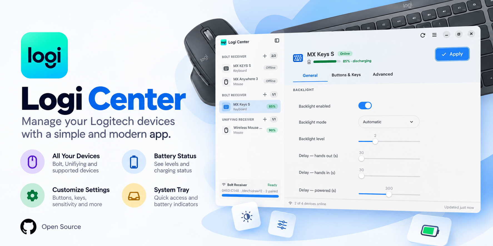

# Logi Center

A modern, easy-to-use manager for Logitech devices, built with Rust and GTK4.

**Made for Fedora with the GNOME desktop (tested on Fedora 44).**

**Version 1.0.0**



## What you can do

- See connected mice, keyboards and USB cameras in one place.
- Check battery and charging status.
- Adjust DPI, scrolling, buttons, keyboard lighting and other supported controls.
- Save device settings and restore them after reconnecting or waking up.
- Create named and application-specific profiles.
- Configure shortcuts, gestures and DPI presets on supported devices.
- Manage compatible receivers and Easy-Switch hosts.
- Use light or dark mode, your GNOME accent color and your preferred language.

Available settings depend on the device and firmware. Logi Center only shows controls reported by the selected device.

## Camera preview and settings

USB cameras appear beside your other devices. Numeric camera controls use sliders and update the camera live.

Camera preview is **off by default**. Click **Start preview** to enable it and **Pause preview** to release the camera for other applications. Video stays on your computer: there is no audio capture, recording or uploading.

Click **Save settings** to keep your confirmed camera configuration. It is stored privately and restored for the same physical camera when you first open its settings in an app session.

## Install on Fedora

Download the latest RPM from [GitHub Releases](https://github.com/christosdaggas/Logi-Center/releases), then run:

```sh
sudo dnf install ./logicenter-1.0.0-1.fc44.x86_64.rpm
```

Open **Logi Center** from the application menu. If a receiver is not detected, reconnect it after installation.

Optional helpers enable extra functionality:

- `v4l2-ctl` for camera controls
- `ffmpeg` for camera preview
- `ratbagctl` and `ratbagd` for supported gaming mice

Logi Center does not download or install these helpers automatically.

## GNOME compatibility

Logi Center supports GNOME on Wayland and uses native GTK4/libadwaita widgets. The main window works without additional extensions.

The system tray requires an AppIndicator or KStatusNotifierItem extension. An optional, read-only GNOME extension is included for application-specific profiles; it is not installed or enabled automatically.

Closing the window keeps the tray running when available. Use **Quit** to exit completely.

## Build from source

Install the build tools on Fedora:

```sh
sudo dnf install rust cargo gcc pkgconf-pkg-config gtk4-devel libadwaita-devel rpm-build
```

Run the app:

```sh
cargo run --locked
```

Build an RPM and its checksum in `dist/rpm/`:

```sh
bash scripts/build-rpm.sh
```

Run the checks:

```sh
cargo test --locked
cargo fmt --check
python3 scripts/check-features.py
```

The GTK integration check requires `gtk4-broadwayd` and uses a private test display. Hardware support still needs testing with your own devices.

## Contact and license

Website: [chrisdaggas.com](https://chrisdaggas.com)

Email: [info@chrisdaggas.com](mailto:info@chrisdaggas.com)

Logi Center is free and open-source software licensed under **GPL-2.0-or-later**.
